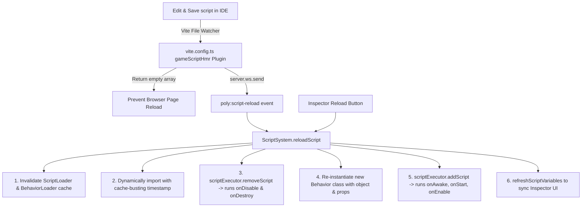

To hot-reload a specific script without reloading the browser page, three coordinated layers are required:

---

### Why It Previously Required a Page Reload

1. **Vite's HMR Fallback**: Because game scripts in `Game/` were not accepted by any HMR boundary, Vite’s default behavior on saving a script was to trigger a full page reload (`[vite] page reload`).
2. **ES Module & Loader Caching**: [ScriptLoader](file:///Users/jisan/Documents/project-poly/PolyForge3D/Core/Loaders/ScriptLoader.ts) and [BehaviorLoader](file:///Users/jisan/Documents/project-poly/PolyForge3D/Core/Loaders/BehaviorLoader.ts) permanently cached the imported class constructor.
3. **Active Script Tracking**: In [ScriptSystem](file:///Users/jisan/Documents/project-poly/PolyForge3D/Core/Systems/Script.system.ts), `this.activationMask.has(entity.uuid)` marked running entities as active and skipped them on every frame, so active instances were never refreshed.

---

### How the Hot Reload Solution Works

The hot-reload system has been implemented across the engine:



---

### Key Implementations

#### 1. [vite.config.ts](file:///Users/jisan/Documents/project-poly/PolyForge3D/vite.config.ts) — Intercepting Vite HMR
Added a Vite plugin (`gameScriptHmr`) with `handleHotUpdate`. When any file inside `Game/` (e.g. `Game/files/playerController.ts`) is saved:
- It sends a custom WebSocket event `poly:script-reload` with the changed file path.
- It returns `[]` to tell Vite **not** to trigger a full page reload:

```typescript
function gameScriptHmr() {
    return {
        name: "game-script-hmr",
        handleHotUpdate({ file, server }: any) {
            const normalized = file.replace(/\\/g, "/");
            if (normalized.includes("/Game/") && /\.(ts|js)$/.test(normalized)) {
                if (normalized.includes(".system.") || normalized.includes(".plugin.")) return;
                server.ws.send({
                    type: "custom",
                    event: "poly:script-reload",
                    data: { file: normalized }
                });
                return []; // Suppresses full page reload!
            }
        }
    };
}
```

#### 2. [Core/Systems/Script.system.ts](file:///Users/jisan/Documents/project-poly/PolyForge3D/Core/Systems/Script.system.ts) — Live Reload Lifecycle
- Listens to `poly:script-reload` via Vite's `import.meta.hot`.
- Implemented `public async reloadScript(scriptPath: string)`:
  - Invalidates module cache in `ScriptLoader` and `BehaviorLoader`.
  - Finds all entities attached to this script (matching relative, `@/`, or absolute path formats).
  - Cleanly calls `this.app.scriptExecutor.removeScript(id)`, executing `onDisable()` and `onDestroy()` on the old instance (tearing down physics bodies, timers, gamepad listeners).
  - Instantiates the fresh class via `behaviorLoader.instantiate(...)` with the existing entity context and properties.
  - Registers the new instance with `scriptExecutor.addScript(...)`, executing `onAwake()`, `onStart()`, and `onEnable()`.
  - Notifies listeners and calls `refreshScriptVariables()` to update the Inspector UI.

#### 3. [Core/Loaders/ScriptLoader.ts](file:///Users/jisan/Documents/project-poly/PolyForge3D/Core/Loaders/ScriptLoader.ts) & [BehaviorLoader.ts](file:///Users/jisan/Documents/project-poly/PolyForge3D/Core/Loaders/BehaviorLoader.ts) — Cache Invalidation & Alias Resolution
- Added `resolveScriptKey(url)` to resolve differences between `@/Game/...`, `/Game/...`, and absolute paths.
- Added `invalidateCache(url)` and cache-busting timestamp queries (`?t=${Date.now()}`) so dynamic `import()` fetches the newly compiled code from Vite rather than the browser's ES module cache.

#### 4. [Editor/Plugins/ComponentUI/ScriptComponentUI.tsx](file:///Users/jisan/Documents/project-poly/PolyForge3D/Editor/Plugins/ComponentUI/ScriptComponentUI.tsx) — Inspector Integration
- Clicking the **Reload** icon button in the Inspector now calls `ScriptSystem.instance.reloadScript(scriptPath)` to immediately update the running instance in real-time.
- Subscribes to `ScriptSystem.instance.onScriptReloaded` so if you add or remove `@INumber()`, `@IRef()`, etc. in your code and save, the inspector inputs automatically update without needing to deselect and reselect the object.

---

### How to Use

1. **Automatic (On Save)**: Edit any script in `Game/files/` in VS Code / your IDE and press save (`Cmd+S` / `Ctrl+S`). The script will recompile and hot-reload in the viewport instantly while preserving scene state, camera position, and selection.
2. **Manual (From Inspector)**: Click the reload icon next to the script field in the Inspector component panel.
3. **Programmatically**: Call `ScriptSystem.instance?.reloadScript("/Game/files/playerController.ts")`.