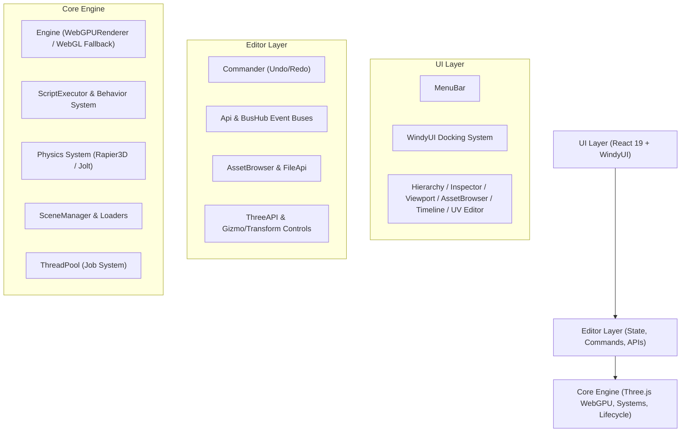

Viewed README.md:1-66
Listed directory Ui
Listed directory components
Viewed PolyForge.ts:1-100
Viewed PolyForge.ts:101-143
Viewed Editor.ts:1-100
Viewed Editor.ts:101-250
Viewed Editor.ts:251-343
Viewed editor_errors.txt:1-60
Ran command: `npx tsc --noEmit`
Viewed DEFINITION.ts:1-31
Used tool: manage_task
Viewed Engine.ts:1-100
Viewed THREE.ts:1-3
Viewed index.html:1-22
Viewed vite.config.ts:1-36
Viewed tsconfig.json:1-29
Viewed App.tsx:1-100
Listed directory Plugins
Listed directory Game
Viewed Api.ts:1-100
Viewed Api.ts:101-107
Listed directory Systems
Listed directory Behavior
Viewed index.ts:1-47

# PolyForge 3D — Comprehensive Project Analysis

**PolyForge 3D** is a full-featured, web-based 3D game engine and editor inspired by Unity and Unreal Engine. It combines a **Three.js (WebGPU/WebGL)** rendering core with a modular **React 19** editor interface, featuring an undo/redo command pattern, dockable windowing, component-based scripting, and integrated physics.

---

## 1. High-Level Architecture

The project is structured into three primary architectural tiers:

---

## 2. Layer-by-Layer Breakdown

### A. Core Engine (`/Core`)
The runtime core responsible for rendering, game loops, component lifecycles, and sub-systems:
- **[PolyForge.ts](file:///Users/jisan/Documents/project-poly/PolyForge3D/Core/PolyForge.ts)**: Singleton engine controller orchestrating time (`Time`), settings, thread pooling (`ThreadPool`), loaders, and scene management.
- **[three/Engine.ts](file:///Users/jisan/Documents/project-poly/PolyForge3D/Core/three/Engine.ts)**: Modern renderer wrapping `three/webgpu`'s `WebGPURenderer` (with automatic WebGL fallback), perspective camera management, and post-processing pipelines (`three/tsl`).
- **[Behavior/index.ts](file:///Users/jisan/Documents/project-poly/PolyForge3D/Core/Behavior/index.ts)**: Unity-style `MonoBehaviour` architecture. Custom game scripts extend `Behavior` to hook into lifecycle events (`onStart`, `onUpdate`, `onDestroy`) and expose customizable properties in the Inspector.
- **[Systems/](file:///Users/jisan/Documents/project-poly/PolyForge3D/Core/Systems)**:
  - `Physics.system.ts`: Integrated physics simulation supporting rigidbodies and colliders via **Rapier 3D** / **Jolt Physics**.
  - `Script.system.ts`: Lifecycle execution and script binding for scene entities.
- **[Parallelism/ThreadPool.ts](file:///Users/jisan/Documents/project-poly/PolyForge3D/Core/Parallelism/ThreadPool.ts)**: Multi-threaded background job runner for compute-heavy tasks.

---

### B. Editor Controller & State (`/Editor`)
The glue between the engine runtime and the React UI:
- **[Editor.ts](file:///Users/jisan/Documents/project-poly/PolyForge3D/Editor/Editor.ts)**:
  - Manages editor states: **`edit`**, **`play`**, and **`paused`**.
  - On `enterPlayMode()`: Auto-saves scene state, transfers control to game cameras, boots scripts and physics.
  - On `exitPlayMode()`: Cleans up runtime scripts, reloads the saved scene state, and restores editor cameras and gizmos.
- **[Commander.ts](file:///Users/jisan/Documents/project-poly/PolyForge3D/Editor/Commander.ts)**: Complete Command design pattern implementation. Every scene modification (transforms, hierarchy changes, property edits, deletions) is wrapped in undoable/redoable command classes.
- **[Api.ts](file:///Users/jisan/Documents/project-poly/PolyForge3D/Editor/Api.ts)**: Centralized facade providing access to scene manipulation (`addTo`, `removeFrom`), object/material serialization, and the typed event bus:
  - **`BusHub`**: Decouples UI from the engine using targeted buses (`sceneUpdate`, `selectionUpdate`, `mutationBus`, `fsUpdate`, `toolChange`, etc.).
- **[FileApi.ts](file:///Users/jisan/Documents/project-poly/PolyForge3D/Editor/FileApi.ts)** & **[AssetBrowser.ts](file:///Users/jisan/Documents/project-poly/PolyForge3D/Editor/AssetBrowser.ts)**: Integrated with `@jisan901/fs-browser` to provide file browsing, drag-and-drop importing, and asset management inside the browser.

---

### C. UI & Workspace (`/Ui`, `WindyUI.tsx`)
A flexible desktop-grade workstation in the browser:
- **[WindyUI.tsx](file:///Users/jisan/Documents/project-poly/PolyForge3D/WindyUI.tsx)** & **[Windy.ts](file:///Users/jisan/Documents/project-poly/PolyForge3D/Windy.ts)**: Custom dockable window manager allowing horizontal/vertical splits, tabs, and panel resizing with state persistence in `localStorage`.
- **Integrated Panels**:
  - **Hierarchy**: Scene tree view with reparenting, grouping, context menus, and search.
  - **Inspector**: Dynamic inspector with transform controls, material properties, and component attachments.
  - **3D Viewport**: Transform gizmos (Translate, Rotate, Scale), camera preview, grid, and drop targets for assets.
  - **Asset Browser & Asset Store**: File explorer for models, textures, scenes, scripts, and prebuilt assets.
  - **Timeline Editor**: Keyframe animation scrubbing and track management.
  - **Specialized Tooling**: UV Editor (`Plugins/uv-editor`), Texture Atlas (`Plugins/TextureAtlas`), Animation Retargeting (`Plugins/Retargeting`).

---

## 3. Technology Stack Summary

| Domain | Technology |
|---|---|
| **Core 3D Engine** | Three.js `v0.185.1` (`three/webgpu`, `three/tsl`), WebGPURenderer |
| **Physics** | `@dimforge/rapier3d` & `jolt-physics` (WASM-based) |
| **Frontend Framework** | React 19 (`react` & `react-dom` `^19.2.1`) |
| **Styling & Icons** | Tailwind CSS `v4` (`@tailwindcss/vite`), Lucide React |
| **Build & Tooling** | Vite 6, TypeScript 5.8, `vite-plugin-wasm` |
| **Virtual FS** | `@jisan901/fs-browser` |

---

## 4. Key Strengths & Technical Highlights

1. **Modern Rendering Engine**: Utilizing Three.js WebGPU renderer with TSL nodes positions the engine for cutting-edge web graphics while retaining WebGL compatibility.
2. **Deterministic Play/Edit Loop**: Clear separation between editing (editor camera, helpers, gizmos) and play mode (game cameras, physics, script execution with state rollback).
3. **Robust Undo/Redo**: Transform changes, property mutations, and hierarchy additions are recorded in history stacks.
4. **Dockable Layout System**: WindyUI provides a flexible, modular multi-panel workspace.

---

## 5. Areas for Attention & Potential Enhancements

1. **TypeScript Health & Legacy Code**:
   - `PolyModule/` and `U/` contain legacy/experimental files that trigger compiler errors (`tsc --noEmit`).
   - `editor_errors.txt` and `ui_errors.txt` highlight several type mismatches (e.g. `isMaterial` checks, `BusHub` typing, missing arguments) that could be resolved to ensure clean type checking across the project.
2. **Physics Integration Consolidation**:
   - Both Rapier3D and Jolt Physics are included in `package.json`; choosing or formalizing a default physics backend will optimize bundle size and maintenance.
3. **Shader / Material Pipeline**:
   - Leveraging Three.js TSL (Three Shading Language) nodes can unlock custom node-based material authoring inside the Texture/Material editors.

---

What specific area would you like to work on or improve next?